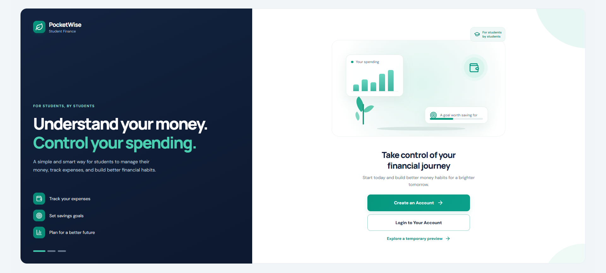
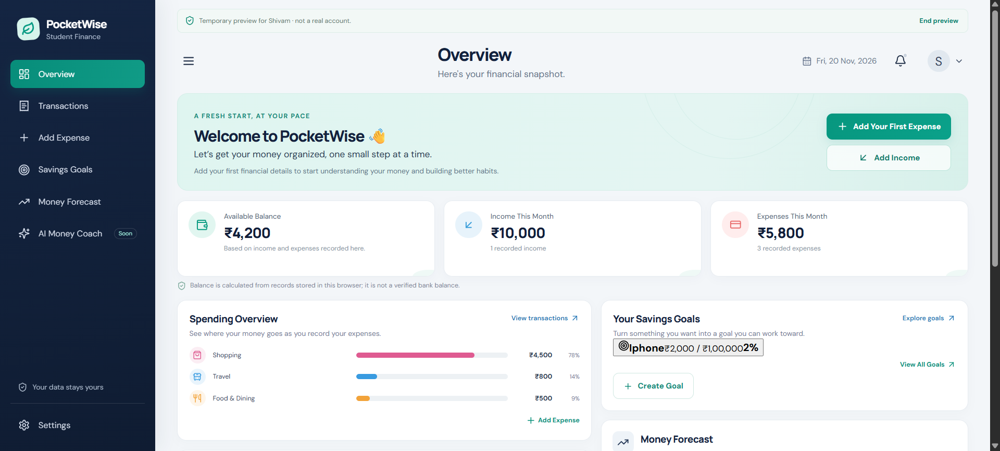
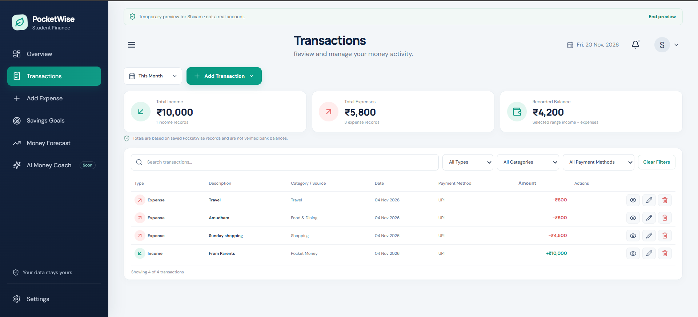
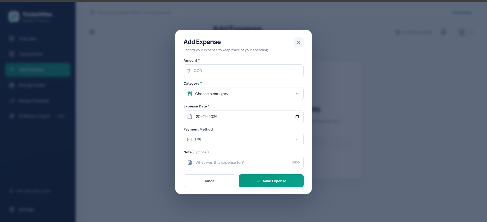
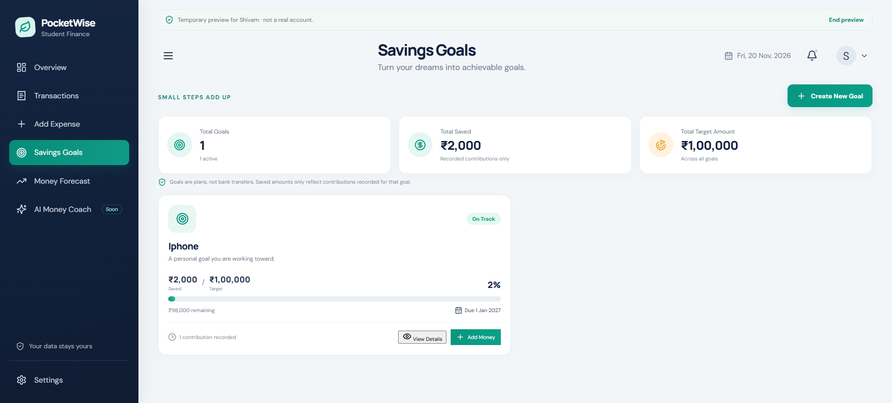
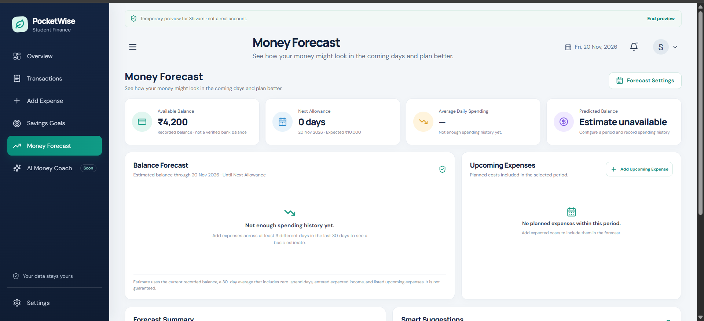
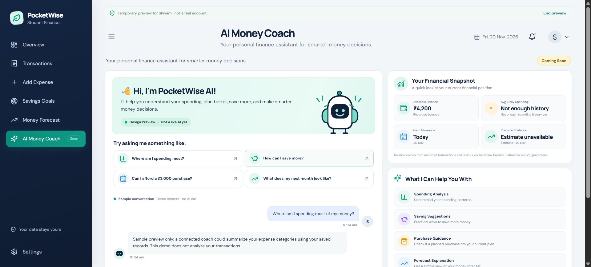

# PocketWise – Student Personal Finance App

**Understand your money. Control your spending.**

PocketWise is a student-focused personal finance application designed to help students track expenses, manage income, set savings goals, and understand their spending patterns.

The project was developed with AI assistance using **OpenAI Codex**, with human direction, feature planning, review, and testing.

## Key Features

- **Dashboard:** Overview of recorded income, expenses, and available balance.
- **Expense Tracking:** Add, edit, delete, search, and filter expenses.
- **Income Management:** Record income and view transaction history.
- **Savings Goals:** Create savings goals, track progress, and record contributions.
- **Money Forecast:** Estimate future balances using recorded financial activity and upcoming expenses.
- **AI Money Coach Preview:** Explore sample financial conversations and a demo interface.

## Technology Stack

**Frontend**
- React.js
- TypeScript
- Vite
- CSS
- Lucide React

**Additional Services**
- Python
- SQLite

**Development Tools**
- Node.js
- npm
- Git and GitHub
- OpenAI Codex (AI-assisted development)

## Getting Started

### Prerequisites

- Node.js 20.19+ 
- npm

### Installation

Clone the repository:

```bash
git clone https://github.com/shivamjaiswal101/Pocketwise.git
```

Move into the project directory:

```bash
cd Pocketwise
```

Install dependencies:

```bash
npm install
```

Start the development server:

```bash
npm run dev
```

Open the local URL displayed in your terminal.

## Testing and Production Build

Run automated tests:

```bash
npm test
```

Create a production build:

```bash
npm run build
```

The older Python/SQLite finance service modules remain separate and are not wired to this UI.

## Current Implementation Notes

PocketWise is currently a development project with the following limitations:

- Registration and login are preview interfaces, not real authentication.
- Transaction records are stored in browser localStorage.
- Data is not synchronized across users or devices.
- The AI Money Coach currently runs in demo mode and does not connect to a live AI provider.
- The Python/SQLite finance service is separate and is not integrated with the React interface.
- Savings goal contributions are progress records, not actual bank transfers.
- Displayed balances are calculated from recorded transactions, not verified bank balances.

## Application Screenshots

Explore the PocketWise interface:

### 1. Landing Page


### 2. Dashboard


### 3. Transactions


### 4. Add Expense


### 5. Savings Goals


### 6. Money Forecast


### 7. AI Money Coach


## AI-Assisted Development

OpenAI Codex was used as an AI coding assistant during development.

The project involved defining requirements, planning features, guiding implementation, reviewing generated code, and testing application functionality.

## Future Improvements

- Secure user authentication
- Backend integration
- Persistent cloud database
- Live AI Money Coach integration
- Improved financial insights
- Responsive design enhancements

## Project Status

**Development version – ongoing improvements.**

---

Built as an AI-assisted student personal finance project.

